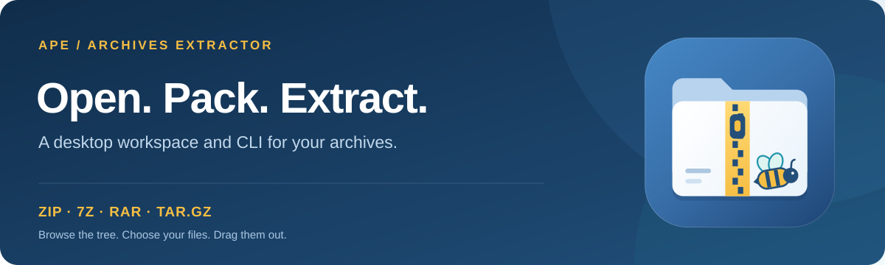

<div align="center">
  

  <h1>ApeArchivesExtractor</h1>

  <p>Browse, create and extract archives from a desktop app or the command line.</p>

  <p>
    <a href="https://github.com/GiancaGIS/ApeArchivesExtractor/releases/latest"><strong>Download for Windows</strong></a> ·
    <a href="#features">Features</a> ·
    <a href="#quick-start">Quick start</a> ·
    <a href="#command-line">CLI</a> ·
    <a href="docs/BUILDING.md">Build from source</a>
  </p>

  <p>
    <a href="https://github.com/GiancaGIS/ApeArchivesExtractor/actions/workflows/security.yml"></a>
    <a href="pyproject.toml"></a>
    <a href="pyproject.toml"></a>
    <a href="LICENSE"></a>
  </p>
</div>



ApeArchivesExtractor combines a searchable archive tree, selective extraction
and configurable compression in a PySide6 interface. The same archive engine
also powers `ape-arch`, a CLI for scripts and terminal workflows.

## Features

| Workflow | What you can do |
| --- | --- |
| **Browse** | Explore a folder tree with native file icons, filter archive contents and reopen recent archives. |
| **Extract** | Unpack everything, choose individual members, or extract directly beside the archive. |
| **Drag & drop** | Open archives by dropping them into the app; drag selected files or folders out to extract them. |
| **Create** | Pack files and folders, choose a compression level, and split ZIP, 7z or RAR output into volumes. |
| **Protect** | Create password-protected 7z and RAR archives. |
| **Stay in control** | Follow progress, cancel operations, inspect logs and confirm overwrites. |
| **Integrate** | Use Windows file associations, Explorer actions and an archive information tab in file properties. |
| **Choose your interface** | Switch between English and Italian, or use the CLI for repeatable tasks. |
| **Follow your system theme** | Use Windows light or dark mode, including dialogs and update toasts; open windows adapt when the system palette changes. |

### Supported formats

| Format | Browse & extract | Create | Create with a password |
| --- | :---: | :---: | :---: |
| ZIP | ✓ | ✓ | — |
| 7z | ✓ | ✓ | ✓ |
| RAR | ✓* | ✓* | ✓* |
| TAR.GZ | ✓ | ✓ | — |

**RAR support:** extracting compressed RAR files may require an external tool
such as UnRAR, unar, 7-Zip or bsdtar. Creation requires the official `rar`
executable or WinRAR. The app searches `PATH` and standard WinRAR installation
folders; use `APEARCH_RAR` to specify an executable. These tools are not bundled
and retain their own license terms.

Numbered ZIP/7z volumes (`.001`, `.002`, …), classic split ZIP sets
(`.z01`, `.z02`, … and `.zip`) and legacy RAR volumes (`.r00`, `.r01`, …)
can be opened from any recognized volume. Keep all parts together.

## Screenshots

**Browse and extract** — navigate archive contents and select the files you need.


<details>
  <summary><strong>Create an archive</strong> — format, compression, passwords and volume size</summary>


</details>

## Quick start

### Windows installer

Download the installer from [GitHub Releases](https://github.com/GiancaGIS/ApeArchivesExtractor/releases/latest).
The packaged application includes its Python runtime; a separate Python
installation is not required. Install for the current user or for all users,
then open an archive from the app or Explorer.

The **Add ape-arch to PATH** installer option is selected by default. It adds
the console command for the current user, or for all users when choosing a
system-wide installation. Close and reopen your terminal after installation,
then run `ape-arch --help`. Uninstalling removes the PATH entry added by the
installer while preserving existing entries.

Windows may ask you to confirm the default archive app in **Settings → Apps →
Default apps**. Explorer actions are available through the classic context menu;
Windows 11's first-level menu additionally requires a trusted, signed identity
package. See the [Windows build guide](docs/BUILDING.md#windows) for details.

### Run from source

Use **Python 3.11+** on Windows, macOS or Linux. Clone this repository, then run:

```bash
python -m venv .venv
```

Activate the environment with `.venv\Scripts\Activate.ps1` in Windows PowerShell,
or `source .venv/bin/activate` on macOS/Linux, then install and launch:

```bash
python -m pip install -e .
apearchivesextractor-gui
```

To open a file immediately, run `apearchivesextractor-gui archive.zip`.
The Windows installer is the packaged distribution; macOS and Linux users can
run from source. Native macOS builds are documented in the
[build guide](docs/BUILDING.md#macos).

### Extract with drag & drop

Open an archive, select files or folders with **Ctrl/Shift**, then drag them
to a destination folder in your file manager. Keep the mouse button held while
the app prepares the selection; preparation shows progress and supports
cancellation. Folder contents are preserved, duplicate names receive a numeric
suffix, and the source archive stays intact.

## Archive properties in Windows

Right-click an archive in Explorer, choose **Properties**, then open the
**APE archive** tab (**Archivio APE** on Italian Windows). The installer offers
this integration by default when the native extension is included.

The tab shows format, archive and original sizes, file/folder counts,
compression methods, detected volumes, encryption and available safety notes.
You can copy the report or open the archive in the app. Inspection runs outside
Explorer, with resource limits and cancellation when the page closes.
Encrypted headers or damaged archives can limit the available information.
Contents are never extracted; this is not a file-integrity test.

This C++ extension works on Windows 10/11 and is independent of the signed
identity package needed by the Windows 11 modern context menu.

## Command line

Use `ape-arch` after installing from source or using the Windows installer
with the PATH option enabled. The longer `apearchivesextractor` alias is also
available for source installations.

```bash
# Browse and extract
ape-arch info archive.zip
ape-arch info archive.7z --json
ape-arch list archive.zip
ape-arch extract archive.7z -o ./extracted
ape-arch extract archive.zip -o ./selected --member docs/readme.txt --member images/logo.png

# Create archives; the output extension selects the format
ape-arch create backup.zip ./documents
ape-arch create backup.tar.gz ./documents
ape-arch create backup.7z ./documents --compression-level 6

# Split output into 100 MB volumes
ape-arch create backup.7z ./documents --volume-size 100M

# Prompt for a password without putting it in shell history
ape-arch create protected.7z ./documents --password -
```

Use `--format 7z` to select a format explicitly. Volume sizes accept bytes,
`K`/`KB`, `M`/`MB`, `G`/`GB` and `KiB`/`MiB`/`GiB`. Run `ape-arch --help` or
`ape-arch <command> --help` for all options.

The GUI also accepts `--extract-here archive.zip`, `--create-archive file.txt folder/`
and `--open-as-zip file.whl`. The last option opens ZIP-based files such as
`.whl`, `.jar`, `.docx`, `.xlsx` and `.epub`.

## Updates

The app checks for new stable GitHub Releases at startup using GitHub's official
public API over HTTPS, without a token. A dismissible toast announces an update;
opening the release page and installing it are user actions. Automatic checks
stay silent when offline or already up to date.

Use **Help → Check for updates** for a manual check, or disable startup checks
under **Options**. Drafts, prereleases and older versions are ignored.

## Security

Extraction validates member paths and rejects path traversal and unsafe links.
Default limits are **100,000 entries**, **16 GiB total extracted size**,
**8 GiB per file**, and a **1000:1 compression ratio** where compressed sizes
are available. These checks reduce the risk from malicious archives.

The [security workflow](.github/workflows/security.yml) runs tests on Windows
with Python 3.11 and 3.14, and audits the resolved runtime, test and build
dependencies with `pip-audit`. It runs on pull requests, selected branch pushes,
a weekly schedule and manual dispatch. Reports are retained as workflow
artifacts. Dependabot proposes weekly Python and GitHub Actions updates.

The audit checks known package advisories; bundled native libraries, external
RAR tools and dependencies in previously published binaries need separate review.

## Development

Install the development and packaging tools, then run the tests:

```bash
python -m pip install -e ".[dev,package]"
python -m pytest -q
```

See [Building and releasing](docs/BUILDING.md) for portable builds, the Windows
installer, macOS bundles, icon generation and release checks. Contributor and
coding guidance lives in [AGENTS.md](AGENTS.md).

Report bugs or propose improvements through
[GitHub Issues](https://github.com/GiancaGIS/ApeArchivesExtractor/issues), including
your OS, app version and steps to reproduce. Use a small sample archive without
private data when one is needed.

## License

ApeArchivesExtractor is licensed under **GPL-3.0-only**, without warranty.
See [LICENSE](LICENSE) and the
[application notice](src/apearchivesextractor/legal/NOTICE.txt).
Earlier versions of the project's own code distributed under MIT retain those terms.

PySide6/Qt and the compression libraries retain their own copyrights and
licenses. Packaged applications include collected license texts and the exact
component inventory under **Help → Licenses and source code**; the CLI provides
`ape-arch --license`.

Binary releases must include the matching source companion. See
[SOURCES.md](SOURCES.md) for source availability and rebuilding, and the
[release instructions](docs/BUILDING.md#publishing-a-release) before distributing
a package.
