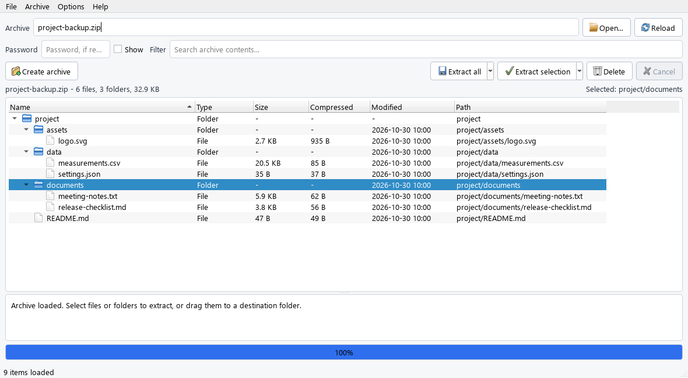
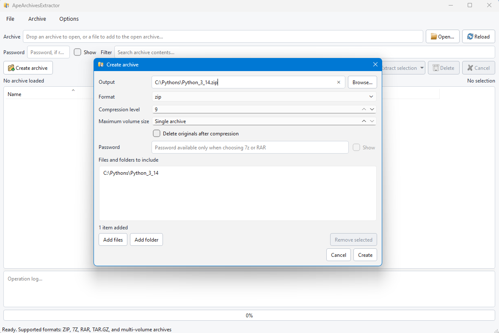

# ApeArchivesExtractor

ApeArchivesExtractor is a small cross-platform archive manager written in Python. It provides both a PyQt6 desktop application and a command-line interface, with the archive-handling core kept separate from the GUI.

## Supported formats

| Format | List | Extract | Create | Password-protected creation |
| --- | --- | --- | --- | --- |
| `.zip` | Yes | Yes | Yes | No |
| `.7z` | Yes | Yes | Yes | Yes |
| `.rar` | Yes | Yes | Yes* | Yes* |
| `.tar.gz` | Yes | Yes | Yes | No |

Numbered 7Z/ZIP volumes (`.001`, `.002`, ...), classic split ZIP sets
(`.z01`, `.z02`, ... + `.zip`), and legacy RAR volumes (`.r00`, `.r01`, ...)
can be opened from any recognized volume. RAR decompression requires a compatible
tool such as UnRAR, unar, 7-Zip, or bsdtar when the compression method is not
handled directly by `rarfile`.

RAR creation requires the official `rar` command or WinRAR. The executable is
detected from `PATH` and standard WinRAR installation folders; alternatively,
set `APEARCH_RAR` to its full path. The RAR backend is not redistributed with
ApeArchivesExtractor.

ZIP encryption is intentionally excluded to avoid providing a false sense of security or compatibility. Password-protected archive creation is supported for 7z and RAR files.

## Screenshots

### Main Window



### Compress window



## Features

- PyQt6 desktop interface.
- Hierarchical archive tree with native file and folder icons.
- Archive content filtering.
- Drag and drop support.
- Drag selected files and folders from an open archive to a desktop folder to
  extract them. Use Ctrl/Shift for multiple selection. The application prepares
  the selection before the copy; keep the mouse button held until it is ready.
  Preparation shows progress and can be cancelled. Selected folders keep their
  contents, and items with the same name receive a numeric suffix. The original
  archive is preserved.
- Full or selective extraction.
- Extract-to-folder and extract-here actions.
- Archive creation from files and folders.
- Password support for compatible archives.
- Configurable compression level.
- Background workers, progress reporting, cancellation, and operation logs.
- Persistent preferences and window geometry through `QSettings`.
- Recently opened archives menu.
- Optional confirmation before overwriting existing files.
- Command-line interface for listing, extracting, and creating archives.
- Protection against archive path traversal.
- Windows file associations and Explorer context-menu integration, including
  numbered (`.001`) and classic ZIP/RAR (`.z01`, `.r01`) volume sets.
- Single-instance handling for archive-creation requests from the Windows shell.

## Requirements

- Python 3.11 or newer.
- Windows, macOS, or Linux.

## Development setup

Create a virtual environment:

```bash
python -m venv .venv
```

On Windows PowerShell:

```powershell
.\.venv\Scripts\Activate.ps1
python -m pip install --upgrade pip
python -m pip install -r requirements.txt
```

On macOS or Linux:

```bash
source .venv/bin/activate
python -m pip install --upgrade pip
python -m pip install -r requirements.txt
```

`requirements.txt` installs ApeArchivesExtractor in editable mode together with the
development, testing, and packaging tools declared in `pyproject.toml`.

## Running the GUI

After installation, run:

```bash
apearchivesextractor-gui
```

Alternatively:

```bash
python -m apearchivesextractor.gui.app
```

An archive can also be opened directly:

```bash
apearchivesextractor-gui archive.zip
```

The GUI entry point supports additional options used by the Windows shell integration:

```text
apearchivesextractor-gui --extract-here archive.zip
apearchivesextractor-gui --open-as-zip file.whl
apearchivesextractor-gui --create-archive file.txt folder/
```

`--open-as-zip` is useful for ZIP-based formats such as `.whl`, `.jar`, `.docx`, `.xlsx`, and `.epub`.

## Command-line usage

List an archive:

```bash
apearch list archive.zip
apearch list archive.7z
apearch list archive.tar.gz
```

Extract an archive:

```bash
apearch extract archive.zip -o ./extracted
apearch extract archive.7z -o ./extracted
apearch extract archive.tar.gz -o ./extracted
```

Extract selected members by repeating `--member`:

```bash
apearch extract archive.zip -o ./extracted \
  --member docs/readme.txt \
  --member images/logo.png
```

Create an archive:

```bash
apearch create output.zip ./folder
apearch create output.7z ./folder
apearch create output.rar ./folder
apearch create output.tar.gz ./folder
```

Create a numbered multi-volume ZIP, 7Z, or RAR archive by setting the maximum
size of each part:

```bash
apearch create output.zip ./folder --volume-size 100M
apearch create output.7z ./folder --volume-size 100M
apearch create output.rar ./folder --volume-size 100M
```

These commands create numbered parts such as `output.zip.001`,
`output.7z.001`, or `output.rar.001`, followed by `.002` and subsequent
volumes as needed. Accepted units include bytes, `K`/`KB`, `M`/`MB`,
`G`/`GB`, and their `KiB`/`MiB`/`GiB` forms. The GUI exposes the same option
in megabytes for ZIP, 7Z, and RAR output.

The format is normally inferred from the output extension. It can also be specified explicitly:

```bash
apearch create output.archive ./folder --format 7z
```

Set the compression level with `--compression-level` or `-l`:

```bash
apearch create output.zip ./folder --compression-level 6
```

Create a password-protected 7z or RAR archive and prompt for the password securely:

```bash
apearch create protected.7z ./folder --password -
apearch create protected.rar ./folder --password -
```

Prefer `--password -` instead of writing the password directly on the command
line. Inline passwords can be stored in shell history or exposed to other local
process inspection tools.

Run `apearch --help` or `apearch <command> --help` for the complete option reference.
The extended `apearchivesextractor` command remains available as an alias.

## Tests

Run the automated test suite with:

```bash
pytest -q
```

## Packaging

PyInstaller is not a cross-compiler. Build the Windows package on Windows and the macOS package on macOS.

### Windows

From PowerShell in the project root:

```powershell
.\scripts\build_windows.ps1
```

If script execution is restricted by the system policy, run it explicitly with a process-level bypass:

```powershell
powershell -NoProfile -ExecutionPolicy Bypass -File .\scripts\build_windows.ps1
```

The portable application is generated in:

```text
dist\ApeArchivesExtractor
```

To create the Windows installer, double-click `build_installer.bat`, or run:

```powershell
.\scripts\build_windows_installer.ps1
```

If required by the PowerShell execution policy:

```powershell
powershell -NoProfile -ExecutionPolicy Bypass -File .\scripts\build_windows_installer.ps1
```

This requires [Inno Setup 6](https://jrsoftware.org/isinfo.php). The generated installer is:

```text
dist\ApeArchivesExtractorSetup-1.0.2.exe
```

The installer includes the collected license texts. The build prepares the
matching source archive and verifies license files, sources and binary checksums
before compilation. For an existing portable build whose sources are already
prepared, use `.\scripts\build_windows_installer.ps1 -SkipBuild`.
Arguments passed to `build_installer.bat` are forwarded to the PowerShell script;
on failure, the launcher keeps the error visible. See
[RELEASE_CHECKLIST.md](RELEASE_CHECKLIST.md) for the publishing steps.

The installer asks whether to install ApeArchivesExtractor for the current user only or for
all users:

- Current user: installs under the user's profile, normally
  `%LOCALAPPDATA%\Programs\ApeArchivesExtractor`.
- All users: requests administrator privileges and installs under Program Files,
  normally `C:\Program Files\ApeArchivesExtractor`.

It creates a Start menu shortcut and registers the application for `.zip` and
`.7z` files for the current Windows user.

Windows 10 and 11 may still require manual confirmation under **Settings > Apps > Default apps** before ApeArchivesExtractor becomes the default double-click handler.

The installer adds these Explorer context-menu actions:

- **Open with ApeArchivesExtractor** for ZIP, 7Z, RAR, and multi-volume archives.
- **Open as ZIP archive with ApeArchivesExtractor** for any file.
- **Extract here with ApeArchivesExtractor** for ZIP, 7Z, RAR, and multi-volume archives.
- **Create archive with ApeArchivesExtractor** for files and folders.

On Windows 11, ApeArchivesExtractor can also expose the same actions in the modern first-level
context menu. This requires two additional Windows build prerequisites:

- Visual Studio 2022 Build Tools with the C++ workload, to build
  `ApeArchivesExtractorShellExtension.dll`.
- Windows SDK with `MakeAppx.exe` and `SignTool.exe`, plus a trusted code-signing
  certificate for the sparse identity package.

When those tools are available, the Windows build script attempts to produce:

```text
dist\ApeArchivesExtractor\ApeArchivesExtractorShellExtension.dll
dist\ApeArchivesExtractor\ApeArchivesExtractorIdentity.msix
```

To sign the identity package during the build, set:

```powershell
$env:APEARCHIVESEXTRACTOR_SIGNING_CERT = "C:\path\to\certificate.pfx"
$env:APEARCHIVESEXTRACTOR_SIGNING_PASSWORD = "certificate-password"
.\scripts\build_windows_installer.ps1
```

If the identity package is missing or not signed with a certificate trusted by
Windows, the installer keeps the legacy context-menu integration and skips the
Windows 11 modern menu registration.

To register the file associations without the installer after building the application:

```powershell
.\scripts\register_file_associations.ps1 -InstallPath ".\dist\ApeArchivesExtractor\ApeArchivesExtractor.exe"
```

Execution-policy-compatible command:

```powershell
powershell -NoProfile -ExecutionPolicy Bypass -File `
  .\scripts\register_file_associations.ps1 `
  -InstallPath ".\dist\ApeArchivesExtractor\ApeArchivesExtractor.exe"
```

To also request ApeArchivesExtractor as the default application:

```powershell
.\scripts\register_file_associations.ps1 `
  -InstallPath ".\dist\ApeArchivesExtractor\ApeArchivesExtractor.exe" `
  -SetDefault
```

Execution-policy-compatible command:

```powershell
powershell -NoProfile -ExecutionPolicy Bypass -File `
  .\scripts\register_file_associations.ps1 `
  -InstallPath ".\dist\ApeArchivesExtractor\ApeArchivesExtractor.exe" `
  -SetDefault
```

To remove the associations:

```powershell
.\scripts\register_file_associations.ps1 -Unregister
```

Execution-policy-compatible command:

```powershell
powershell -NoProfile -ExecutionPolicy Bypass -File `
  .\scripts\register_file_associations.ps1 `
  -Unregister
```

To manually register only the Windows 11 modern context-menu integration after a
signed build:

```powershell
.\scripts\register_windows11_context_menu.ps1 `
  -InstallDir ".\dist\ApeArchivesExtractor" `
  -PackagePath ".\dist\ApeArchivesExtractor\ApeArchivesExtractorIdentity.msix"
```

To remove it:

```powershell
.\scripts\register_windows11_context_menu.ps1 `
  -InstallDir ".\dist\ApeArchivesExtractor" `
  -PackagePath ".\dist\ApeArchivesExtractor\ApeArchivesExtractorIdentity.msix" `
  -Unregister
```

### macOS

```bash
./scripts/build_macos.sh
```

The generated application is placed in:

```text
dist/ApeArchivesExtractor.app
```

The macOS build must be run on macOS. It generates `.icns` icons from the SVG
assets, creates a native `.app` bundle, and declares ZIP, 7Z, RAR, multi-volume, and TAR.GZ file
types in the app bundle metadata. Distribution outside local use still requires
the usual Apple code-signing and notarization steps.

## Security

The [Security regression workflow](.github/workflows/security.yml) runs on pull
requests, pushes to `main`, `master` and `develop`, every Monday at 07:17 UTC,
and manually from GitHub Actions. It runs the test suite on Windows with Python
3.11 and 3.14, including the hostile archive and packaging regression cases.

Each job exports its exact installed dependencies and checks them with
[`pip-audit`](https://github.com/pypa/pip-audit), including transitive dependencies
and test/build tools. The auditor runs in a separate environment. Known
vulnerabilities or audit errors fail the job; there are no advisory exclusions
or automatic fixes. Test results, the dependency inventory, pinned requirements
and the audit report are retained as workflow artifacts for 30 days, including
when a test or audit fails. Dependabot proposes weekly updates for Python
dependencies and GitHub Actions.

This checks known advisories for the package versions resolved in CI. It does
not replace review of native libraries embedded in wheels, external RAR tools,
or dependencies in an older packaged release. Scheduled workflows run from the
repository's default branch, so the workflow must be present there to run weekly.

ApeArchivesExtractor validates archive member paths before extraction and blocks unsafe paths such as:

```text
../file.txt
../../another-file
/absolute/path
C:\Windows\...
```

The GUI can also warn before extraction would overwrite existing files in the destination directory.

ApeArchivesExtractor also applies extraction safety limits to reduce the risk of archive bombs:

- maximum 100,000 archive entries;
- maximum 16 GiB of total extracted data;
- maximum 8 GiB for a single extracted file;
- maximum 1000:1 compression ratio for formats that expose compressed sizes.

## License

ApeArchivesExtractor is released under **GNU GPL version 3 only
(GPL-3.0-only)**. See [LICENSE](LICENSE) and [NOTICE](NOTICE). You may redistribute
and modify the application under those terms. There is no warranty.

The GUI uses the GPLv3 version of PyQt6. Third-party libraries retain their own
copyrights and licenses, including the LGPL terms of Qt and the compression
libraries. Packaged applications include complete collected license texts and
an exact component inventory, available from **Help > Licenses and source code**.
The CLI also provides `apearch --license`.

Before publishing binaries, prepare the matching source companion with
`python scripts/prepare_release_sources.py` and complete
[RELEASE_CHECKLIST.md](RELEASE_CHECKLIST.md). Run `python scripts/check_release.py`
before compiling an installer. For macOS pass `--bundle dist/ApeArchivesExtractor.app`
to both commands. Publish the generated source ZIP next to the binary downloads.
See [SOURCES.md](SOURCES.md) for source availability and rebuilding with modified
dependencies. The Windows installer script prepares sources and checks license
files, source archives and binary checksums before compiling the installer.

The project's own code previously distributed under MIT retains that original
license for those versions. This does not change the licenses of dependencies.

## Disclaimer

The software is distributed on an "AS IS" BASIS, WITHOUT WARRANTIES OR CONDITIONS OF ANY KIND, either express or implied.
